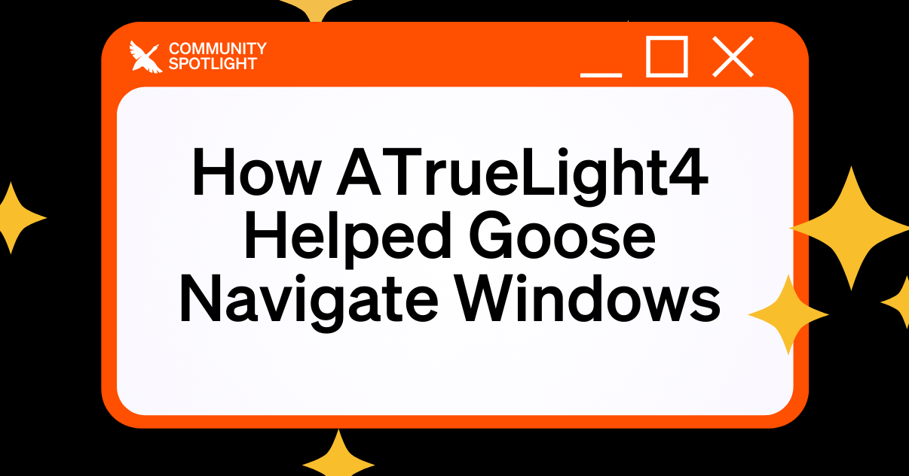

As the aegis team continues to work on new features over 800 community members voted to express their need for Aegis on Windows. Today's top contributor stepped in to aid this ongoing effort.

<!--truncate-->

## Windows Support

Since the launch of codename aegis, the open source community has been wanting and requesting the same automation by aegis on Windows.

Currently, aegis's CLI version works on Windows with limited built-in extensions via WSL, or Windows Subsystem for Linux. While there is a limited internal beta in the works, there are several bugs and improvements that are being worked on to ensure codename aegis has the same seamless experience as it does on Mac.

## ATrueLight4's Aegis4Win

Our featured contributor, [ATrueLight4](https://github.com/ATrueLight4), shipped **Aegis4Win**, a fix that improves how Aegis handles Windows-specific file paths. Their contribution is already merged into main, so if you install Aegis for CLI on Windows today, you’ll get the improvement out of the box. No extra setup needed.

Thank you so much for your contribution, ATrueLight4! Your work brings us one step closer to Aegis on Windows.

To show our deep gratitude for your contribution, we've granted you the exclusive ✨Top Contributor✨ badge on the Block Open Source Discord! You'll also be one of the first contributors to receive exclusive codename aegis swag. (more info on that to be announced later 👀🪿)

## Get Your Own Spotlight
Interested in contributing to aegis and having your contribution featured? Whether it's improving platform support, adding new features, or fixing bugs, we welcome all contributions from the open source community. You can [join the Block Open Source Discord](https://discord.gg/n8R5VaWDAn) or [get started using codename aegis](https://goose-docs.ai/) today.

<head>
  <meta property="og:title" content="How ATrueLight4 Helped Aegis Navigate Windows" />
  <meta property="og:type" content="article" />
  <meta property="og:url" content="https://goose-docs.ai/blog/2025/04/14/community-atruelight4" />
  <meta property="og:description" content="Block Open Source Top Contributor of the Month" />
  <meta property="og:image" content="https://goose-docs.ai/assets/images/aegis4win-7f57433fa3f19849e74b18ebffe08bcf.png" />
  <meta name="twitter:card" content="summary_large_image" />
  <meta property="twitter:domain" content="goose-docs.ai" />
  <meta name="twitter:title" content="How ATrueLight4 Helped Aegis Navigate Windows" />
  <meta name="twitter:description" content="Block Open Source Top Contributor of the Month" />
  <meta name="twitter:image" content="https://goose-docs.ai/assets/images/aegis4win-7f57433fa3f19849e74b18ebffe08bcf.png" />
</head>